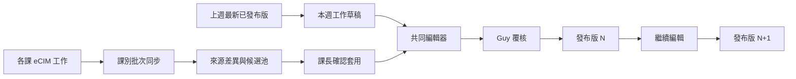

# 處會週報共同編輯解決方案設計

狀態：設計版，2026-09-26。依 [Wayfinder 決策地圖](../.scratch/weekly-report-collaboration/map.md) 撰寫；週報內容版型見 [report-structure.md](report-structure.md)。本文件供後續正式系統開發與驗收使用。

## 1. 目標與邊界

一、二、三課課長與處級主管 Guy 在公司內網網站共同完成每週處會報告。系統以上週**最新已發布版**延續未結案事項，並讓各課從工程師 eCIM 工作批次同步候選變更。課長判斷哪些事項值得報告、補充週會決議；Guy 統整跨課與處級摘要並發布。每次發布留下固定版號、連結與當時內容，發布後可繼續編輯及重新發布。

本次設計涵蓋流程、資料模型、畫面、權限、鎖定、來源同步、輸出與驗收。不包含既有系統的遷移計畫。需求單 MCP 目前不存在，設計預留新增來源的介面，現階段不依賴它。

### 既有實作的可用基礎

- `weekly-report` 以 eCIM `get_work_review` 取得工程師工作，已有 `s1/s2` 抓取及高工時／異常詳情補充；第三課成員與擷取時窗尚待設定。
- `weekly-meeting-report` 以舊週報與工程師工作產生草稿，目前編輯器在 `127.0.0.1:8080`，使用單一暫存 JSON，`/api/save` 儲存整份週報。這可供資料解析及排版參考，不能直接充當四人共用寫入服務。
- 2026-09-24 處會 JSON 有 8 個專案與 143 筆待分配工作；專案時程多寫在敘述中，缺少可直接產生甘特圖的結構化日期。

## 2. 每週作業流程

| 時間 | 負責人 | 動作 |
| --- | --- | --- |
| 新週草稿建立時 | 系統 | 由前週最新已發布版延續未結案項目、來源關聯、負責人及未解事項；完成項目僅保留本週一次結案摘要。 |
| 週二上午／下午 | 一課／二課課長 | 可在各自週會前後同步本課 eCIM 工作、挑選變更並編寫本課內容。 |
| 週三全天至下班前 | 三位課長 | 隨時編輯所屬內容；週會後補充討論決議。週三下班前各課內容以可供 Guy 整理為目標，系統不硬性於特定分鐘鎖住。 |
| 週四上午 | Guy | 統整跨課內容、管理摘要、排序、來源缺漏與風險，必要時退回補充或親自編輯。 |
| 週四 13:30 處會前 | Guy | 發布首次正式版，取得固定連結。會前或會後可繼續編輯，重新發布為新版。 |

課長的「內容已確認」是進度提示，不是禁止後續補充的閘門。若來源匯入失敗，畫面明示失敗及上次成功時間；不得把失敗視為零工作或無異常。Guy 可在資料未齊時發布，但正式頁顯示待補來源。

## 3. 人員、責任與授權

前端沿用 `D:\Projects\ums-app` 的 `template` 分支完成 SSO 登入並取得 JWT。後端從 UAC 內網 JWKS 取得 RSA／RS256 公鑰，驗證 JWT 簽章與 `exp`，再以 `empNo` 對照本系統 SQLite 中的角色、課別與讀者名單，於每個 API 檢查授權。現有 token 未提供 `sub`、`iss` 或 `aud`，因此不把這些欄位列為驗證必要條件；`empID` 為 AD 帳號，`empName` 僅供顯示。前端隱藏按鈕不能代替後端檢查。內網部署先使用 `http://tncimweb1.cminl.oa/uacapi/.well-known/jwks.json`，取得失敗時不可接受未知金鑰簽發的 token。

| 角色 | 讀取與編輯 |
| --- | --- |
| 各課課長 | 閱讀授權範圍內的報告；同步本課工作；建立、編輯及確認本課項目。對跨課專案可更新自己承擔的工作並提出變更。 |
| 專案週報維護人 | 從四位共同編輯者中指定，維護該專案的整體敘述、階段、里程碑、時程及管理紀錄。實際專案負責人另行記錄，可屬其他部門。 |
| Guy | 編輯所有非敏感限制項目、管理跨課摘要與排序、指定維護人、覆核並獨自發布及重新發布。 |
| 處會報告讀者 | 只讀取有權看的已發布版本，不進入編輯草稿。 |

跨課專案由指定週報維護人更新專案資料，Guy 負責處級整合與最終發布。人事異動草稿只對 Guy 和相關課長顯示及開放編輯；其他課長不可看到該項目。已發布的人事內容也僅對具處會報告讀取權限者顯示，內容限生效日期、職責交接及工作影響。

## 4. 邏輯資料模型

採用具交易與唯一性約束的 SQLite 共用資料庫，部署於單一 ASP.NET Core 9 服務及持久磁碟。所有編輯請求經過共用後端服務。既有 JSON/HTML 是來源或匯出格式，不能作為多人同時寫入的權威資料。

| 實體 | 主要欄位與關係 | 規則 |
| --- | --- | --- |
| `Report` | `id`, `meeting_at`, `period`, `working_version`, `latest_publication_id` | 一個處會日期對應一份持續編輯的工作草稿。 |
| `ReportItem` | `id`, `continuity_id`, `report_id`, `topic`, `owner_section`, `maintainer_id`, `status`, `sort_order`, `version`, `closed_at` | `continuity_id` 跨週穩定；同一事實只在一張主卡詳述，其他章節用連結引用。 |
| `Project` | `item_id`, `goal`, `actual_owner`, `participating_units`, `health`, `health_reason`, `optional_percent` | 專案是特化項目，不套用維運需求的通用欄位。百分比不由工時自動推算。 |
| `Phase` / `Milestone` | `project_id`, `name`, `baseline_start/end`, `forecast_start/end`, `actual_start/end`, `owner`, `state`, `depends_on` | 甘特圖顯示階段及重要里程碑；工程師工單在詳情中連結，不逐筆畫入甘特圖。 |
| `ProjectRecord` | `project_id`, `kind`, `description`, `impact`, `owner`, `due_at`, `state` | `kind` 為風險、已發生問題、跨部門相依或待決策事項。 |
| `SourceRef` | `item_id`, `source_type`, `source_id`, `source_period`, `url`, `import_run_id` | 支援上週項目、eCIM Work ID、文件連結；未來可新增需求單來源。 |
| `FieldOrigin` | `item_id`, `field_name`, `last_source_value`, `latest_source_value`, `report_value`, `human_override`, `edited_at` | 來源差異與人工覆寫按欄位判斷，不用文字比對推測。 |
| `ImportRun` | `section_id`, `period`, `started_at`, `finished_at`, `member_results`, `state` | 記錄每位工程師成功、失敗及資料時效；同一來源重匯不得製造重複候選。 |
| `Candidate` | `source_ref`, `suggested_topic`, `reason`, `decision`, `target_item_id` | 課長決定建立、合併、暫緩或忽略；系統分類只作建議。 |
| `EditLease` | `item_id`, `holder_id`, `token_hash`, `expires_at`, `base_version` | 同項目同時一位編輯者；租約 30 分鐘，可續期。 |
| `PrivateDraft` | `item_id`, `editor_id`, `lease_id`, `content`, `saved_at` | 編輯中自動暫存；其他人看不到，按「儲存完成」才寫入共用項目。 |
| `AuditEvent` / `Publication` | 操作者、時間、變更原因、前後值；發布版號、快照與固定連結 | 發布版不可被原地修改；時程基準變更保留歷史。 |

`ReportItem.topic` 限於本週管理摘要、專案、重要需求、重大異常、人事異動、新技術評估；工程師明細及來源附錄由已關聯資料生成。需要跨章顯示時採引用，不複製一份可各自編輯的內容。

## 5. 來源同步與項目延續

課長手動執行「同步本課工程師進度」。後端依可設定的課別成員及擷取時窗，對每人呼叫 eCIM `get_work_review`；必要時取 `get_work_detail`。匯入記錄完整的成功／失敗狀態，不用空陣列替代失敗。第一、二、三課使用相同資料處理流程，課別不應寫死為 `s1/s2`。

同步只提出差異：新增來源、來源進度／狀態／工時變更、疑似完成、疑似重大異常，以及已有人為覆寫的衝突欄位。課長逐項接受、合併、保留人工值或暫緩。來源值改變時，`human_override=true` 的欄位保留報告值並顯示來源最新值。未經人確認，不改寫管理敘述、專案時程、風險判斷或已發布版。

上週已發布的未結案項目沿用 `continuity_id` 建立本週版本；上週待決事項須顯示決策結果或新期限。完成事項由負責課長確認，本週留一次結案摘要，下週退出正文並可從歷史查閱。重大異常已恢復但永久改善未完成時，改善項目繼續追蹤。

重要需求與重大異常的正文入選由課長判定；系統可把 eCIM 工作標為候選，不能自行宣告重要或重大。未來需求單 MCP 可作為另一個 `source_type` 與候選提供者，仍走同一人工確認流程。

## 6. 協作、暫存與發布狀態

1. 開始編輯項目時，後端以交易取得 30 分鐘排他租約，顯示編輯者及到期時間；持續操作可續期。其他人仍可閱讀最後已儲存內容。
2. 編輯器自動把內容儲存為該編輯者的私有草稿，清楚顯示「儲存中／草稿已儲存／離線」。側欄關閉或瀏覽器離開前提示未提交內容。
3. 按「儲存完成」時，後端同一交易檢查 JWT 權限、租約 token、項目 `base_version` 及資料有效性，更新該項目、寫入稽核紀錄、遞增版本並釋放租約。不得以整份報告覆寫其他人的項目。
4. 租約到期或版本不符時，回應衝突並保留私有草稿供比較與重套；不靜默覆寫。必要的管理接管須記錄操作者與原因。
5. Guy 發布時取得一致的工作版快照，寫入不可變的 `Publication`。後續編輯仍對工作草稿進行；再次發布產生新版固定連結，舊版仍可查閱。

建議 API 契約：`GET /reports/{id}`、`GET /reports/{id}/items/{itemId}`、`POST /imports/{section}`、`GET /imports/{runId}/candidates`、`POST /items/{id}/lease`、`PUT /items/{id}/private-draft`、`POST /items/{id}/commit`、`POST /reports/{id}/publications`、`GET /publications/{id}`。寫入回應包含新版本；權限錯誤、鎖定及版本衝突分別明確回覆。具體路徑名稱可配合既有後端慣例調整，但語意與交易邊界應維持。

## 7. 編輯器與報告頁

編輯器以「章節與項目導覽、主編輯區、來源與歷史對照」組成；導覽與對照側欄都可收合，中央編輯區可取得幾乎全寬。完整預覽可關閉或全頁開啟。專案可切到全寬甘特圖；圖上點選階段／里程碑後以表單更改日期及填原因，不以拖曳直接改日期。

正式報告為唯讀網站頁面，顯示版號、發布時間、來源完整度、六段章節及專案摘要與甘特圖。頁面支援投影及瀏覽器列印；需要 PDF 時先透過瀏覽器列印輸出。人事區塊依讀者權限在後端決定是否提供。詳細欄位與編排見報告架構文件。

## 8. Prototype 與驗收

設計完成後的 Prototype 使用既有處會週報真實資料的記憶體複本，只供 Guy 在本機查看，不遮蔽內容、不回寫原始 JSON。Prototype 著重比較三種排版，以專案卡示範試編輯、變更示意時程、檢視甘特圖、預覽與重發布測試版；其他章節以既有內容檢視版型。四人同時編輯與 SSO 以模擬狀態說明，不作正式安全驗證。原週報沒有結構化專案日期，因此 Prototype 的甘特圖日期須明顯標為示意。

正式系統的驗收至少涵蓋：四人同時登入並編輯不同項目；同項目排他鎖與到期衝突；私有草稿不出現在共用內容；課別重匯不覆蓋人工值；三課資料皆可獨立同步；人事草稿權限；專案時程修改留下原因及歷史；週三補週會決議、週四上午 Guy 編輯；發布後修訂產生新固定版號；舊版可查且列印版式可用。

## 9. 實作時需提供的資料

三課成員與課長公司 `empNo`、各課 eCIM 擷取時窗、內網主機與持久磁碟／備份位置、處會報告讀者名單。Angular Template 與 JWT claim 契約、UAC JWKS URL、eCIM `GET /Work/ReviewWork` 已於 [實作規畫](implementation-plan.md) 核對。這些值作為設定與整合輸入，不改變本文件確立的業務流程。
